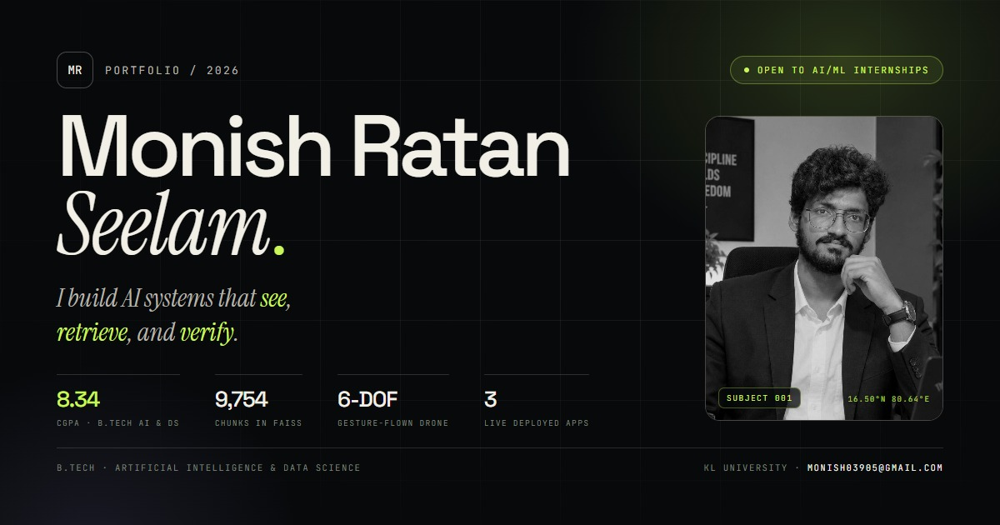

<div align="center">



# Monish Ratan Seelam — Portfolio

**AI systems that see, retrieve, and verify.**

[](#)
[](#)
[](#)
[](#)

</div>

A single-page portfolio for Monish Ratan Seelam — B.Tech Artificial Intelligence & Data
Science at KL University (8.34 CGPA), building retrieval, computer vision and full-stack
systems. Everything on this site runs in the browser: no server, no API keys, no tracking.

## What's inside

| Section | What it does |
| --- | --- |
| **Hero + 3D dossier card** | Drag the portrait card to rotate it, tap or press Enter to flip. The back is an AI dossier with metrics, skill meters and a live signal log. |
| **Profile** | The see → retrieve → verify thread, quick facts and current focus. |
| **Selected work** | Eight shipped projects with filterable categories, full case-study dialogs, and arrows to source or live demo. |
| **Retrieval Lab** | Ask a question about Monish. A TF-IDF vectorizer builds embeddings in the browser, cosine similarity ranks passages, and the top 3 documents come back with scores and excerpts. |
| **Stack / Journey / Credentials** | Skill meters, timeline, and verifiable certificates (PDF). |
| **GitHub** | Live repository, language and activity data straight from the GitHub API. |
| **Contact** | Email, résumé, and profile links. |

Also included: a `Ctrl/⌘+K` command palette, dark/light themes, a custom cursor, a
loading sequence, reduced-motion support, and a mobile layout down to 390px.

## Tech

- **React 19** + **Vite 8**, plain CSS with custom properties (no UI framework)
- **framer-motion** for reveal/scroll animations, **lucide-react** for icons
- **Playwright** (dev-only) for OG-image rendering and screenshot QA
- Deployed as a fully static site — `dist/` is the entire product

## Quick start

```bash
npm install
npm run dev        # http://localhost:5173
npm run build      # production bundle in dist/
npm run preview    # serve the built bundle
```

Requires Node 20+.

## Project structure

```text
src/
  data/content.js      profile, stats, projects, experiments, skills, journey, credentials
  lib/retrieval.js     corpus + TF-IDF index + cosine search for the lab
  components/          Hero, PortraitCard, Work, CaseStudy, Lab, Stack, Journey,
                       Credentials, Github, Contact, CommandPalette, Nav, ...
  styles/              base tokens, shell, hero, work, lab, sections
  assets/portrait.jpg  hero portrait
public/                résumé, certificates, OG image, favicon
scripts/
  og.cjs               renders public/og.jpg (1200×630 social card)
  shots.cjs            Playwright screenshot suite (desktop, mobile, themes)
  verify.cjs           console-error + interaction smoke check
```

## Updating content

Almost everything is data-driven — no component edits needed for routine updates:

- **Projects / skills / timeline / certifications** → `src/data/content.js`
- **What the Retrieval Lab knows** → `corpus` in `src/lib/retrieval.js` (titles, text, tags)
- **Documents** → `public/` (résumé PDF, certificate PDFs)

The lab's index rebuilds automatically at load time (`buildIndex`), so document and
vocabulary counts on screen always match the corpus.

## How the Retrieval Lab works

1. **Chunk** — corpus entries are treated as documents
2. **Embed** — tokens are stemmed, stop-worded, and weighted with TF-IDF
3. **Retrieve** — the query vector is expanded with synonyms and prefixes, then scored
   against every document by cosine similarity
4. **Ground** — the top 3 passages are shown with match scores and the best-matching
   sentence, so answers can be checked instead of trusted

The same loop — ingest → embed → retrieve → ground — is what AURA runs in production
with FAISS and MiniLM-L12-v2 over 9,754 chunks; this demo swaps in a smaller corpus
and a lightweight vectorizer to stay dependency-free.

## Deployment

The build is static, so any host works:

- **Netlify / Vercel** — build command `npm run build`, publish directory `dist`
- **GitHub Pages** — publish `dist/` with any static workflow; `base` may need to be
  set in `vite.config.js` if served from a subpath

## Accessibility

- Semantic landmarks, skip link, visible focus rings
- The dossier card is a real button with `aria-pressed` and per-face `aria-hidden`
- Keyboard support throughout (palette, card flip, case-study Escape/navigation)
- `prefers-reduced-motion` disables scans, tickers and transitions
- Contrast-checked type pairs in both themes

## License

Personal portfolio content and design. The code is free to read and learn from;
please don't republish the identity, copy, or photographs as your own.
